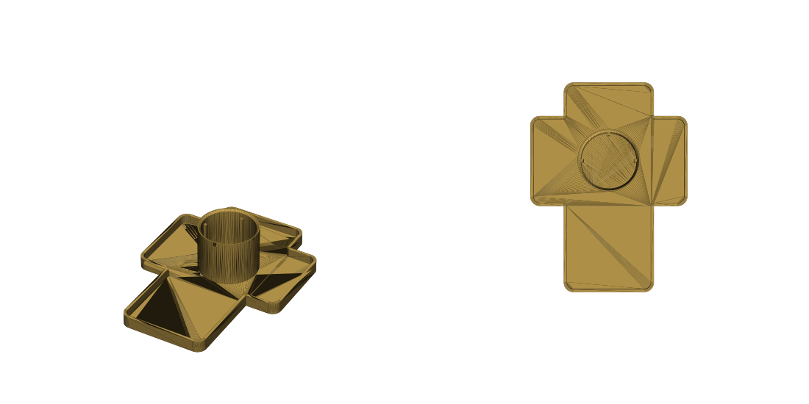

# Portavela con cruz — paramétrico

Portavela en forma de **cruz latina** para velas de parafina (iglesia).

- **Bandeja en cruz con borde**: recoge la cera que gotea.
- **Base plana**: se para firme en el piso.
- **Brazo largo = mango**: se sostiene cómodo en la mano.
- **Tubo central con 4 nervios**: aprietan la vela aunque varíe un poco su grosor.



## STL listos

| Archivo | Vela | Tamaño | Material |
|---|---|---|---|
| `portavela_cruz_D20.stl` | Ø20 mm | 64 × 86 × 21 mm | ~10 g |
| `portavela_cruz_D22.stl` | Ø22 mm | 66 × 88 × 21 mm | ~10.5 g |
| `portavela_cruz_D25.stl` | Ø25 mm | 69 × 91 × 21 mm | ~11.5 g |

## Cambiar el diámetro

**Python** (`pip install manifold3d numpy`):
```
python3 generar_stl.py --diametro 24
python3 generar_stl.py --diametro 30 --altura-tubo 25 --mango 50
```
`python3 generar_stl.py -h` muestra todos los parámetros.

**OpenSCAD**: abrir `portavela_cruz.scad`, cambiar `diametro_vela` (o usar el Customizer), F6 y exportar STL.

## Impresión (< 30 min)

- Capa **0.28 mm** (perfil "draft"), boquilla 0.4
- Relleno 15 % (casi todo es pared sólida igual)
- **Sin soportes**, sin brim; se imprime tal cual (base abajo)
- PLA sirve; **PETG** aguanta mejor el calor
- Bambu / Prusa MK4 / K1: ~15–20 min. Ender 3 de serie: puede pasar de 30 min → bajar `--mango` y `--brazo`.

⚠️ El plástico se ablanda con el calor: no dejar que la llama baje a menos de ~3 cm del tubo y nunca dejar la vela encendida sin supervisión.
